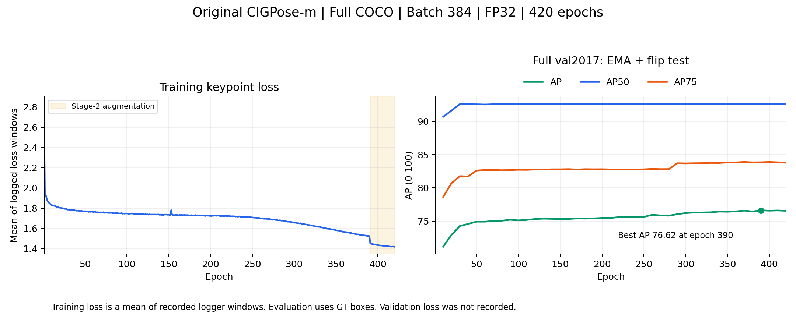

# 原版CIGPose-m，全量COCO，420轮

本实验从作者仓库 https://github.com/53mins/CIGPose 的提交 7086d7907e93fe15dce3ede7967aabe5af8c88ec 复制源码；训练相关源码逐文件核对Git对象摘要。原始配置为cigpose-m_1xb384-420e_coco-256x192.py，模型及训练超参数沿用作者配置。

| 训练设置 | 实际值 |
| --- | --- |
| GPU | 单卡RTX 5090 |
| 输入 | 高256 × 宽192，COCO 17点 |
| 模型参数量 | 14,304,732 |
| 数据 | 全部COCO train2017图片及原始关键点标注 |
| 有效训练样本 | 56,599张图中的149,813个人体 |
| batch | 训练384，验证64 |
| 精度及轮次 | FP32，420轮 |
| 初始化 | 作者指定的CSPNeXt-M AIC+COCO姿态预训练骨干 |
| 优化器 | AdamW，初始lr=0.001，weight_decay=0.05 |
| 调度 | 前1000步预热；第211轮起余弦学习率；第391轮起第二阶段增强 |
| 验证 | 每10轮一次，共42次，完整val2017、GT人体框、EMA及翻转测试 |

| 指标 | 最佳AP轮次，第390轮 | 第420轮 |
| --- | ---: | ---: |
| AP | 76.6178 | 76.5476 |
| AP50 | 92.6156 | 92.6066 |
| AP75 | 83.8442 | 83.7840 |

AP按0–100展示，JSON保留0–1原始值。成功运行的日志时间为北京时间 2026-11-23 11:39:17 至 2026-11-25 18:57:38，约55.31小时。

## 文件

- [最终及最佳结果](summary.json)
- [42次完整验证指标](ap_history.json)
- [原始MMEngine标量日志](scalars.jsonl)
- [训练日志采样点](train_logged_steps.csv)
- [逐轮日志窗口均值](train_loss_logged_window_means.csv)
- [曲线重绘脚本](plot_curves.py)
- [原始控制台日志](train.log)
- [实际运行配置](recorded_run_config.py)
- [作者源码关键文件快照](source_snapshot)
- [数据摘要、源提交及启动参数](provenance.json)
- [实际软件环境](environment.txt)
- [权重文件名与SHA256](checkpoints.json)
- [原始文件校验信息](original_artifact_sha256.json)



作者原配置只记录训练loss和验证AP。训练曲线采用已记录logger窗口的逐轮算术均值；它不等于全训练batch的精确损失平均。验证loss和遮挡误差在本次原配置运行中未记录。曲线由原始日志离线生成。

启动时曾在第一批数据读取阶段触及系统文件描述符上限，尚未完成训练迭代即退出；提高进程nofile上限后重新成功训练。失败日志保存在initialization_failure_01.log，系统设置见retry_system_limit.json。采用现有5090环境，源码和训练配置保持原样。

checkpoint实体保留在服务器，checkpoints.json提供服务器路径、文件大小和SHA256。最佳和最终文件分别为best_coco_AP_epoch_390.pth与epoch_420.pth。

## 复现入口

按provenance中的作者提交准备代码、完整COCO数据与兼容5090的软件环境，在作者仓库的mmpose目录运行，使用新的输出目录。

```bash
ulimit -n 65536
export TORCH_FORCE_NO_WEIGHTS_ONLY_LOAD=1
python -u tools/train.py projects/cigpose/body_2d_keypoint/cigpose-m_1xb384-420e_coco-256x192.py --work-dir /path/to/new_results
```

训练配置未启用AMP，也未启用自动学习率缩放。数据根目录按作者原配置使用../data/coco/。recorded_run_config.py保留服务器实际解析后的配置，source_snapshot保存作者原始配置及关键实现。
