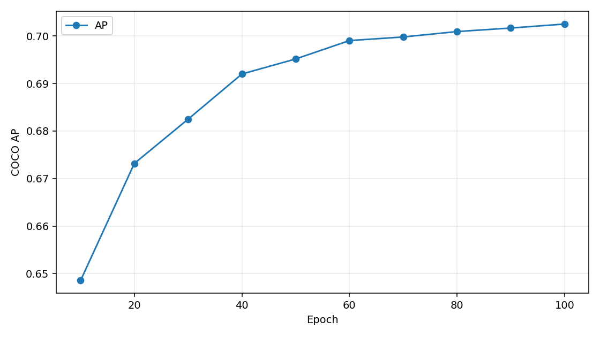
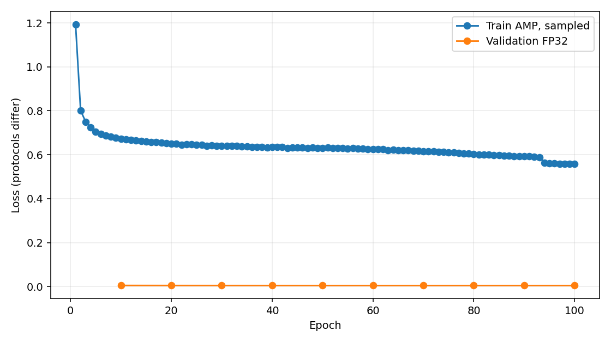

# cim_a — 实验报告

- 状态：**complete**
- 更新时间（UTC）：2026-11-24T10:29:15+00:00
- 最佳 AP：**0.7025188817455154**
- 最佳轮次：100
- 最后验证轮次：100 / 100
- 最后验证 loss：0.004320202710713062
- 训练累计时间：04:28:44
- FLOPs/FPS：未准确测量；不会填入估计数值。

训练 loss 为 AMP 训练日志采样均值；验证 loss 为 FP32，绝对值不宜直接比较。

