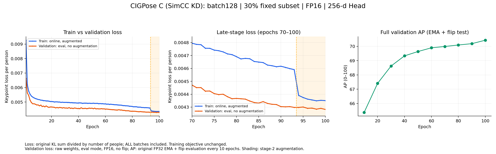

# C 组基础坐标蒸馏，100轮结果

单卡 RTX 5090，固定30% COCO训练子集（16,983张图、44,941个人体）、种子21、训练batch128、验证batch64、FP16、100轮。学生为6,190,372参数的小骨干CIGPose。教师为官方CIGPose-m，冻结完整模型；学生CIM/GNN沿用基线初始化。两者共用增强输入。

损失为原有关键点损失、反事实一致性损失和 0.04969 × SimCC KL，温度0.1。横纵坐标分布各占一半，有效遮挡点和可见点等权。系数标定见[calibration.json](calibration.json)，实际运行源码见[source_snapshot](source_snapshot)。

| 第100轮指标 | 数值 |
| --- | ---: |
| AP | 70.4288 |
| AP50 | 90.5511 |
| AP75 | 78.4251 |
| 遮挡关节平均误差 | 17.944961 原图像素 |
| 遮挡关节数 | 8,365 |

最高AP出现在第100轮，训练及验证计时为16106.15秒。AP按0–100展示，JSON保留0–1原始值。完整验证使用COCO val2017、GT人体框、EMA学生及翻转测试。A组同口径比较保存在comparison.json。

- [100轮训练与验证loss](loss_history.csv)
- [10次完整验证](ap_history.json)
- [最终、最佳和A组对比](summary.json)
- [原始控制台日志](train.log)
- [实际运行配置](recorded_run_config.py)
- [权重文件名与SHA256](checkpoints.json)
- [原始文件校验信息](original_artifact_sha256.json)
- [PDF曲线](train_val_loss.pdf)

图中的train/val为按人体数归一化的监督关键点损失；KD另有CSV列。验证loss使用原始学生、eval模式、FP16和单视图。第94轮起切换增强。原始日志与结果原样归档，训练过程未增加新评估。

原始图脚注中的“Training objective unchanged”应理解为图示监督关键点损失沿用原定义；实际C组总训练损失还包含坐标KD和一致性项，详见本页公式。

source_snapshot和recorded_run_config.py保留服务器运行时路径，用于审计。复现采用[上级目录中的可移植入口](../README.md)。checkpoint实体保留在服务器，checkpoints.json给出路径、大小和SHA256。
