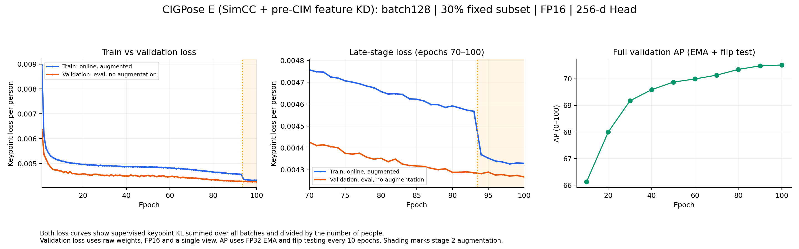

# E 组 100 轮实测结果

本目录保存 2026 年 11 月 23 日在 AutoDL 单卡 RTX 5090 上完成的余弦特征蒸馏实验。训练使用固定 30% 子集（16,983 张图片、44,941 个人体）、训练 batch 128、验证 batch 64、FP16、种子 21 和 100 轮。教师采用官方 CIGPose-m。完整模型及损失设置见[实验说明](../README.md)。

| 第 100 轮完整验证指标 | 数值 |
| --- | ---: |
| AP | 70.5190 |
| AP50 | 90.5493 |
| AP75 | 77.4368 |
| 遮挡关节平均误差 | 17.122293 原图像素 |
| 遮挡关节数 | 8,365 |

以上 AP 指标统一乘 100 展示。原始 JSON 中的 AP 保持 0–1。AP 评估采用完整 COCO val2017、GT 人体框、EMA 学生参数及翻转测试。遮挡误差按全部 v=1 关节的原图坐标欧氏距离汇总。

最高 AP 出现在第 100 轮。遮挡误差单独最低的验证轮次是第 90 轮，误差 17.036585 像素。完整训练及验证计时为 17269.32 秒，约 4.80 小时。

100 轮共记录 35,200 个训练迭代，优化器实际更新 35,187 次，混合精度优化器跳过更新 13 次。逐轮计数保留在 CSV 的 optimizer_steps 和 skipped_optimizer_steps 字段。

## 指标和曲线

- [每 10 轮的完整 AP、AP50、AP75 与遮挡误差](ap_history.json)
- [每轮训练、验证关键点损失及蒸馏项](loss_history.csv)
- [最终和最佳结果](summary.json)
- [训练完成状态](progress.json)
- [运行配置记录](recorded_run_config.py)
- [服务器启动记录](launch_record.json)
- [结果文件 SHA256](artifact_sha256.json)
- [PDF 曲线](train_val_loss.pdf)

曲线中的 train/val loss 都是按人体数归一化的监督关键点损失。CSV 另记录坐标蒸馏及余弦特征蒸馏项。训练损失使用在线增强，验证损失使用原始学生参数、eval 模式、FP16 和单视图。第 94 轮起进入第二阶段增强，完整 AP 每 10 轮评估一次。

`recorded_run_config.py` 和运行记录保留这次服务器上的实际绝对路径，用于审计。复现实验请使用[可移植配置和训练入口](../README.md)。
