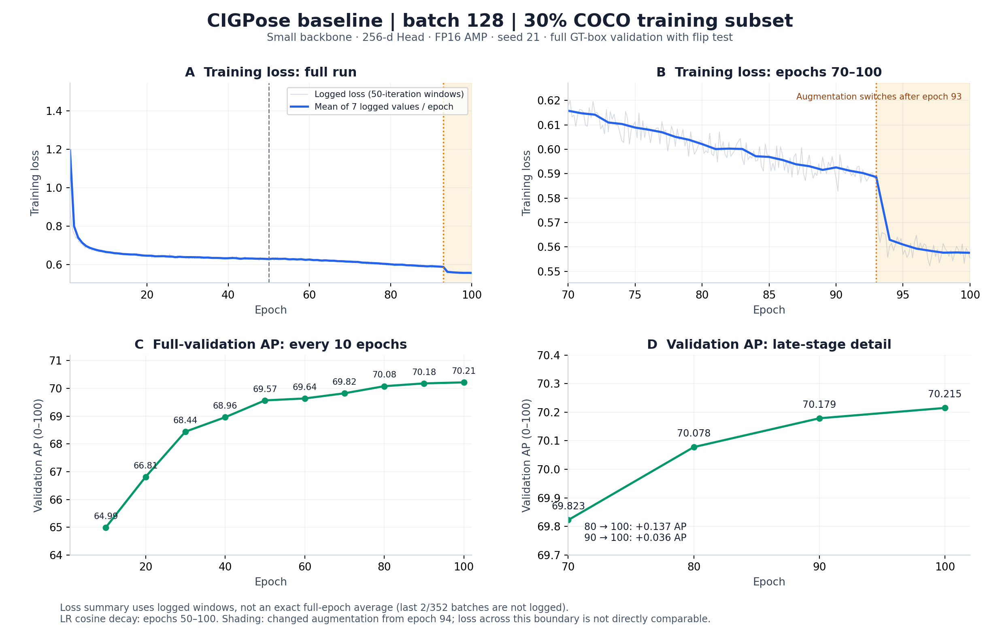

# 当前batch128基线结果

2026-11-20 01:05开始，05:02完成100轮和最终验证，总历时约3小时57分。
最终与最佳AP均为 **70.2148**，最佳轮次100；AP50=90.5693，AP75=78.3732。
30%固定分层训练集、小骨干、256维Head、FP16、train batch128 / val batch64、seed21；完整val2017 GT框评估，flip_test=True。

- `validation_AP.csv`：每10轮完整验证AP（0–100刻度）。
- `epoch_loss_summary.csv`：每轮7条已记录平滑loss的均值和范围，不是全部批次的精确均值；末尾2/352批次未被这些日志覆盖。
- `loss_ap_curves.pdf`：可下载矢量图。

第93轮结束后切换数据增强，从第94轮采用新增强，边界处loss不可直接比较。最后三轮记录均值约0.55763、0.55772、0.55757；最后10轮AP提升0.0362点，当前调度下接近平台期，不能证明加训完全无收益。
完整日志含13条grad_norm非有限的日志记录，loss保持有限；这些是平滑日志窗口，不能据此精确推算AMP跳过更新次数。本结果不应标记为“全程无溢出”。
权重不提交Git；服务器已保存`epoch_100.pth`与`best_coco_AP_epoch_100.pth`。本次整理没有续训。
