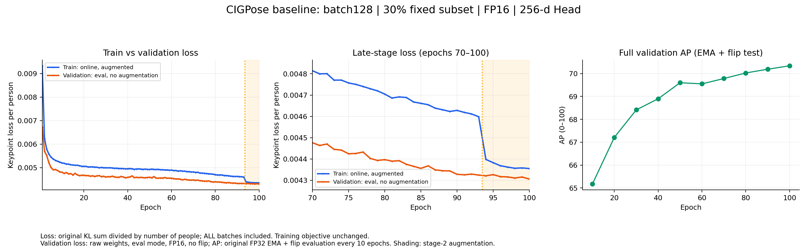

# A 组轻量基线（100 轮）

RTX 5090，固定 30% COCO 训练子集，训练 batch 128、验证 batch 64，FP16，seed 21。完整 val2017 使用 GT 人体框、EMA 权重和翻转测试，每 10 轮评估一次。最佳与最终 AP 均为 **70.3364**（第 100 轮），AP50 为 **90.5401**，AP75 为 **78.3938**，训练与验证共约 4 小时 30 分钟。

[每轮 loss](loss_history.csv) 包含全部 100 轮。训练与验证均把全轮关键点损失总和除以人体实例数。训练包含随机增强，验证 loss 使用当轮原始权重、FP16、单次前向。第 94 轮起使用第二阶段增强。第 100 轮 train loss 为 0.004355，val loss 为 0.004306。

[原始验证指标](ap_history.json) 中 AP 使用 0–1 刻度。图中和本页使用 0–100 刻度。[下载 PDF 曲线](train_val_loss.pdf)。
